<!-- Code generated by `mise run readme` from data/profile.json; DO NOT EDIT. -->

<picture><source media="(max-width: 600px)" srcset="https://github.com/brodienguyen/brodienguyen/raw/main/assets/header-phone.svg"></picture>
<picture><source media="(max-width: 600px)" srcset="https://github.com/brodienguyen/brodienguyen/raw/main/assets/section-01-phone.svg"></picture>
<a href="https://github.com/pulls?q=is%3Apr+author%3Abrodienguyen+is%3Amerged+is%3Apublic+-user%3Abrodienguyen"><picture><source media="(max-width: 600px)" srcset="https://github.com/brodienguyen/brodienguyen/raw/output/upstream-phone.svg"></picture></a>
<picture><source media="(max-width: 600px)" srcset="https://github.com/brodienguyen/brodienguyen/raw/main/assets/section-02-phone.svg">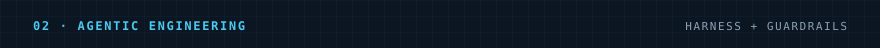</picture>
<picture><source media="(max-width: 600px)" srcset="https://github.com/brodienguyen/brodienguyen/raw/main/assets/agents-phone.svg"></picture>
<picture><source media="(max-width: 600px)" srcset="https://github.com/brodienguyen/brodienguyen/raw/main/assets/section-03-phone.svg">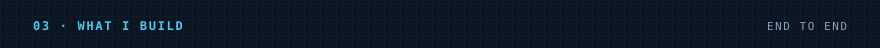</picture>
<picture><source media="(max-width: 600px)" srcset="https://github.com/brodienguyen/brodienguyen/raw/main/assets/build-phone.svg"></picture>
<picture><source media="(max-width: 600px)" srcset="https://github.com/brodienguyen/brodienguyen/raw/main/assets/section-04-phone.svg">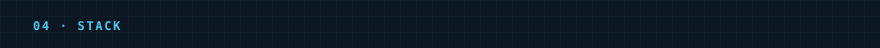</picture>
<picture><source media="(max-width: 600px)" srcset="https://github.com/brodienguyen/brodienguyen/raw/main/assets/stack-phone.svg"></picture>
<picture><source media="(max-width: 600px)" srcset="https://github.com/brodienguyen/brodienguyen/raw/main/assets/section-05-phone.svg">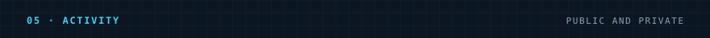</picture>
<picture><source media="(max-width: 600px)" srcset="https://github.com/brodienguyen/brodienguyen/raw/output/city-phone.svg"></picture>
<picture><source media="(max-width: 600px)" srcset="https://github.com/brodienguyen/brodienguyen/raw/main/assets/footer-phone.svg">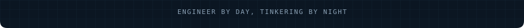</picture>

